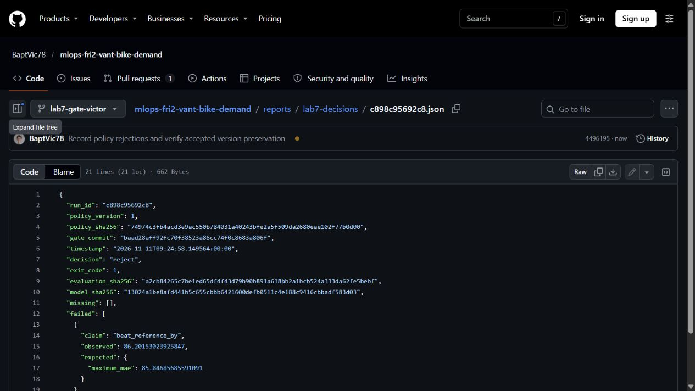
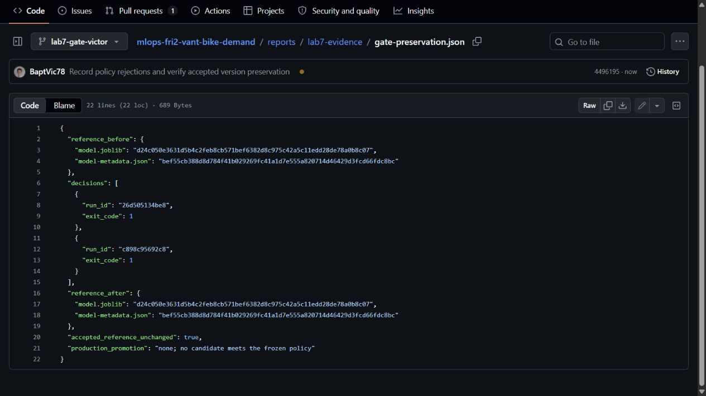
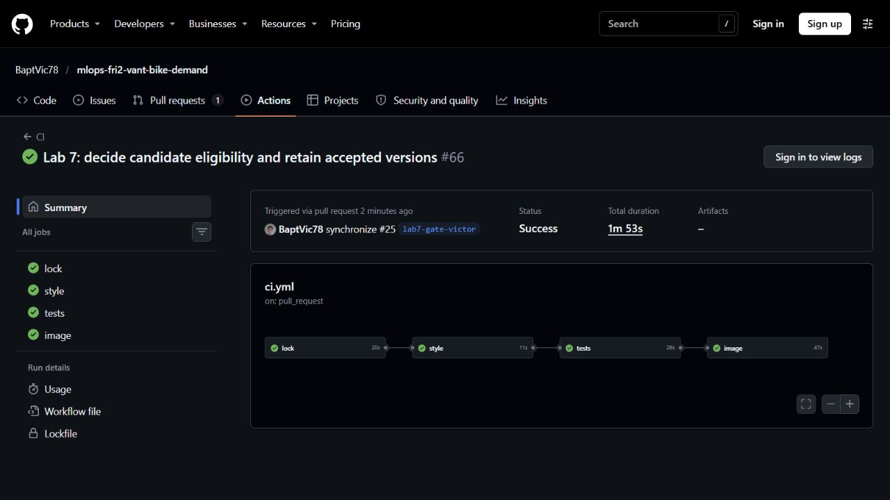

# Lab 7 pipeline preparation

The policy was merged in PR #23 before candidate evaluation.
The pipeline implementation is on the local branch
`lab7-candidate-pipeline`, based on `10b01d4`.

## Candidate command

```sh
uv sync --locked
uv run --locked python -m bike_demand.pipeline --config configs/baseline.yaml --reference artifacts/reference
```

The reference directory must contain the accepted model and metadata. Its
checksum is verified against the policy before unpickling. The model is
rescored on validation before a candidate is trained. The pipeline stages
write into a temporary candidate directory and publish the directory after
the complete evidence and MLflow tracking are saved.

The command produces evidence for the gate. It leaves the accepted model
and metadata intact. Gate decisions, budget accounting and promotion are
the subsequent team tasks.

## Local evidence

The eight synthetic regression cases passed in the locked checkout environment:

```text
.venv/bin/python -m pytest -q tests/test_pipeline.py
8 passed in 113.23s
```

An additional run using the existing Linux environment and this branch's
source via `PYTHONPATH` passed all eight cases in 6.35 seconds.
Ruff lint and formatting passed for the new code and tests.

The tests exercise accepted model and metadata preservation, immutable
candidate output, wrong reference bytes, dirty source, disallowed model
settings and failed-training cleanup. They use a six-row synthetic fixture
and a fixture policy. They consume no real candidate attempts.

## Canonical candidate attempt 1

The candidate command ran from clean commit `5957a2f` on Linux under WSL,
using the existing trusted bundle at
`/home/victor/mlops-fri2-vant-bike-demand/artifacts`. Its reference model
checksum matched the policy. The command exited 0 and produced run
`06c4291bb9bc`. The [evaluation record](lab7-evidence/pipeline-evaluation.json)
and [tracking ID](lab7-evidence/pipeline-tracking.json) preserve the results.

- Reference validation MAE: 86.84685685591091.
- Candidate validation MAE: 86.84685685591091.
- Training-mean validation MAE: 154.23179306864967.
- Candidate checksum: `de2ccb247c32ade78dcd7c43be6209ca03b7065de42fe8578c1b6e25f93482c3`.
- Candidate size: 5,243,809 bytes.
- Saved model readback MAE: 86.84685685591091.
- The accepted reference model checksum remained
  `d24c050e3631d5b4c2feb8cb571bef6382d8c975c42a5c11edd28de78a0b8c07`.

This is the first canonical candidate attempt under policy version 1. Retain
it in the gate's three-candidate budget. The quality evidence shows zero
improvement; the gate must record its formal decision in the subsequent PR.
The candidate model bytes remain in the ignored candidate directory.

Full local verification at this implementation commit used
`uv sync --locked`, locked Ruff lint and formatting, then
`uv run --locked pytest -q`: 168 passed, 2 warnings in 147.19 seconds.
The warnings concern Starlette's test client and SQLAlchemy's loader strategy.
Docker verification is blocked locally because the Docker Desktop Linux
engine pipe is unavailable. The PR image job provides separate runner evidence.

## Second attempt during retry verification

The duplicate-run probe was launched before the evidence commit, but its
Python startup completed after that commit. It therefore read the new clean
commit `b48f810` and produced run `26d505134be8`. The commit is part of the
run identity, so this is a distinct attempt, even with the same model config.
The [second evaluation](lab7-evidence/pipeline-evaluation-retry.json) and
[tracking ID](lab7-evidence/pipeline-tracking-retry.json) retain its evidence.
Count both attempts against policy version 1's budget of three.
Both candidate MAEs equal the reference MAE. Gate decisions remain pending.
The synthetic immutable-output test covers duplicate-run refusal. No further
canonical candidate is needed for this pipeline implementation.

## Victor's gate and retained-version handoff (PR #25)

The gate implementation and final candidate config were committed as
`baad28a`, after the pipeline was merged at `fd844e8`.
The third and final canonical candidate is `c898c95692c8`.
It used 150 trees, depth 20 and minimum leaf size 2. The hypothesis was
declared in the README before the candidate ran. All twelve predictors,
the data snapshot, time partitions, policy margins, seed and worker count
kept their policy values.

| Attempt | Candidate validation MAE | Decision |
|---|---:|---|
| `06c4291bb9bc` | 86.84685685591091 | [reject](lab7-decisions/06c4291bb9bc.json), exit 1 |
| `26d505134be8` | 86.84685685591091 | [reject](lab7-decisions/26d505134be8.json), exit 1 |
| `c898c95692c8` | 86.20153023925847 | [reject](lab7-decisions/c898c95692c8.json), exit 1 |

The policy requires a candidate MAE at most 85.84685685591091.
The last attempt improved by 0.64532661665244 rentals/hour, below the
required 1.0. The budget of three evaluated candidates is exhausted.
All decisions retain the `beat_reference_by` failure, observation and limit.
The [third evaluation](lab7-evidence/gate-candidate-evaluation.json) and
[tracking record](lab7-evidence/gate-candidate-tracking.json) preserve its
model checksum, size, environment, validation scores and readback.

```sh
uv run --locked python -m bike_demand.gate --candidate artifacts/candidates/06c4291bb9bc
uv run --locked python -m bike_demand.gate --candidate artifacts/candidates/26d505134be8
uv run --locked python -m bike_demand.gate --candidate artifacts/candidates/c898c95692c8
```

The first command returned exit 1. The subsequent two returned exit 1 as well.
For an incomplete evidence probe, directory `ffffffffffff` lacked
`evaluation.json`. The gate recorded
[blocked](lab7-decisions/ffffffffffff.json), exit 2, naming the missing file.
That probe produced no model and consumes no evaluated-candidate budget.
Raw subsequent executions are in
[gate-execution.txt](lab7-evidence/gate-execution.txt).

The [preservation check](lab7-evidence/gate-preservation.json) records
identical accepted model and metadata checksums before and after the
second and third decisions. The accepted model remains
`d24c050e3631d5b4c2feb8cb571bef6382d8c975c42a5c11edd28de78a0b8c07`.
No canonical promotion was performed because no candidate qualified.

### Promotion mechanism and limits

Synthetic tests exercise acceptance and promotion using a fixture-specific
policy and six rows. They verify two distinct retained model checksums,
the previous package's presence, atomic pointer replacement and rejection
of post-decision tampering. A simulated interruption before pointer
replacement retains the old state and resumes with the same inputs.
The [test output](lab7-evidence/gate-tests.txt) includes the synthetic
promotion paths and hashes. These fixture outputs are local test evidence.
The production policy and canonical observations above govern real promotion.

The shared pipeline fixture was moved into `tests/conftest.py` so both
suites exercise the same candidate-bundle format. Existing assertions,
including the clean CRLF-checkout regression, were retained.
The pipeline now saves original config bytes for later hash verification.
The gate supports the two earlier bundles through their committed baseline
config and serializes decisions/promotions with an exclusive filesystem lock.

Nils's Cloud Run deployment and retained revision remain the next handoff.
The accepted bundle and its metadata are recoverable from the reference
package used above. Docker Desktop's Linux engine remains unavailable locally.

### Verification and screenshots

At `4496195`, [CI run 42995781526](https://github.com/BaptVic78/mlops-fri2-vant-bike-demand/actions/runs/42995781526)
passed lock, style, the full test suite and the Docker image build.
The [runner's test summary](lab7-evidence/gate-ci-tests.txt) preserves the
test count and warnings. The focused gate suite passed 16 cases locally.
Source provenance checks allow Git LF/CRLF conversion for the dependency
lock while rejecting changed lock content.



The third candidate's saved decision names the observed MAE and required limit.
Screenshot of the real record published in commit `4496195`.



The model and metadata hashes match before and after the rejection checks.
Screenshot of the recorded preservation result in commit `4496195`.



The four jobs passed on `4496195`, run 42995781526. These screenshots
supplement the raw decision, preservation and test records.


## Nils's accepted reference preparation

Nils Giraud owns the accepted-package recovery and Cloud Run handoff for Lab 7.
The three canonical gate decisions remain rejected, so the accepted reference
is retained. This preparation creates no candidate and consumes no attempt.

The [handoff record](lab7-evidence/accepted-handoff.json) records local recovery
from image `sha256:13594e76dc0fcd196df50b3f21c9a707e92a1cdca11aad759be25a7430a7f369`.
Its model checksum matches the policy reference, and the real service loader
accepted the model and metadata. The package is retained under
`artifacts/accepted/versions/d24c050e3631d5b4c2feb8cb571bef6382d8c975c42a5c11edd28de78a0b8c07/`.
The recovered metadata identifies `baseline-f4459fc6e2a4`.

The recovery command is:

```sh
uv run --locked python -m bike_demand.reference_bundle --source artifacts/reference
```

It validates the checksum before loading and reuses the gate's retention and
locking logic. The accepted pointer stays in place. Regression tests cover
repeat recovery, source and pointer preservation, mismatched source bytes and
corruption of an already retained model. Recovery instructions are in the README.

### Live service and retained revision

Victor completed the Cloud Run prerequisite and supplied the deployment handoff
on 11 November 2026. Nils connected with his own Google account and independently
checked the service, both revisions, registry access and the filtered service logs.

| Check | Observed result |
|---|---|
| Project / region / service | `fourth-eon-424715-k1` / `europe-west1` / `bike-demand-lab7` |
| URL | `https://bike-demand-lab7-obot7iy6yq-ew.a.run.app` |
| Health | HTTP 200, `status: ok`, `baseline-28fdf1958b8a` |
| README prediction | HTTP 200, `146.59529728935132`, same expected version |
| Invalid hour `24` | HTTP 422 naming `body.hr` |
| Anonymous health | HTTP 403 |
| Current revision | `bike-demand-lab7-refcurrent80f31db`, Ready, 100% traffic |
| Previous revision | `bike-demand-lab7-refbase80f31db`, retained and Ready, zero traffic |

The [HTTP record](lab7-evidence/cloud-run-nils-http.json),
[revision record](lab7-evidence/cloud-run-nils-revisions.json) and
[request logs](lab7-evidence/cloud-run-nils-logs.json) preserve the observations.
The previous revision is inactive/retired because it receives no traffic; it
still exists and its Ready condition is true. Both revisions use immutable image
`sha256:6dd4148b94859b21b05769af5971892e604fee3c2a3f201c411910a080f932ff`.

Nils pulled that exact image and extracted its bundle into ignored
`artifacts/cloud-reference/`. Its model SHA-256 equals the policy reference
`d24c050e3631d5b4c2feb8cb571bef6382d8c975c42a5c11edd28de78a0b8c07`.
Its metadata SHA-256 is
`bef55cb388d8d784f41b029269fc41a1d7e555a820714d46429d3fcd66fdc8bc`.
The real service loader accepted both files and returned the expected deployed
version. The version label differs from the earlier local archive, while the
model bytes are identical. No candidate was accepted or promoted.

The image labels identify reviewed source `80f31db` and the accepted checksum.
Victor supplied Cloud Build ID `8fdde224-e448-4ba2-8d2e-93a8fcdf7f86`, reported
successful, and the [deployment Dockerfile](lab7-evidence/Dockerfile.accepted)
and [build configuration](lab7-evidence/cloudbuild-accepted.yaml).
Nils checked the supplied Dockerfile checksum and inspected its copy/check/load
steps; it does not train. The Cloud Build logs were not independently read.

The reproducible check is:

```sh
uv run --locked python scripts/check_cloud_run.py --base-url https://bike-demand-lab7-obot7iy6yq-ew.a.run.app --expect-model baseline-28fdf1958b8a
```

It exited 0. A [negative control](lab7-evidence/cloud-run-negative-control.json)
with `--expect-model deliberately-wrong-version` exited 1, as required.
Tokens stay in memory and are excluded from output. README instructions cover
private invocation, exact-package recovery and traffic rollback. No training,
candidate evaluation or traffic change occurred during this verification.
The two retained revisions contain the same accepted reference; a rollback
between different accepted models was not performed.
